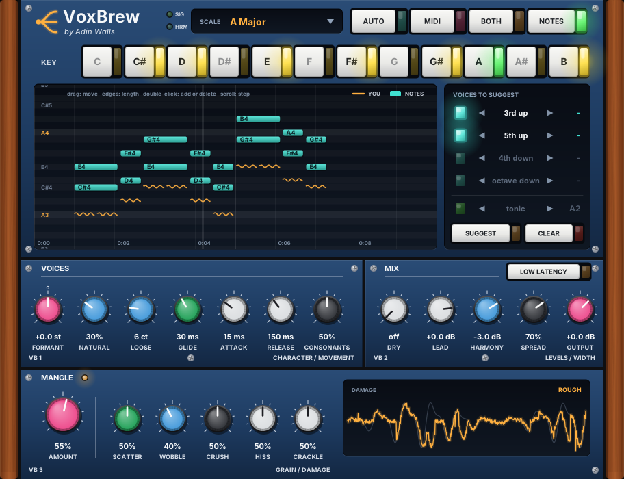

# VoxBrew Harmonizer

*A live vocal harmonizer for Linux, in the spirit of Bon Iver's "Messina".*


Sing into it and it splits your one voice into a stack: a tuned lead, harmonies in key, an optional tonic drone, and voices you play from a MIDI keyboard. Every voice is made from your own voice, so it keeps your vowels and character instead of sounding like a vocoder. MIDI is optional: in **Auto** mode the harmonies follow your singing on their own.

Built on [DPF](https://github.com/DISTRHO/DPF), the same way as the [Adin Brew](https://github.com/adinwalls/adin-brew) plugins. Formats: LV2, VST3 and CLAP (64-bit Linux, glibc 2.35+). Made for Harrison Mixbus 12 on Pop!_OS.

## How it works

```
voice in ──► pitch tracker (YIN, shared) ──► pitch marks
                                              │
            ┌───────────────┬─────────────────┼──────────────┬─────────────────┐
            ▼               ▼                 ▼              ▼                 ▼
       tuned lead     auto voice 1..4     tonic drone    MIDI voices      dry voice
      (snap to key)  (scale steps from   (key root in   (notes you hold,  (delayed to
                      the sung note)     an octave)     up to 10)         line up)
            └──────── each voice: TD-PSOLA grains of your real voice ────────┘
                                         │
                              pan spread + levels ──► stereo out
```

* **One analysis, many cheap voices.** Pitch is tracked once. Each voice only re-spaces two-period grains of the input (TD-PSOLA), which keeps the formants and costs very little: 10 voices use about 3% of one CPU core in the offline test.
* **Tuned lead** is a voice at "0 scale steps", so it's the sung note snapped to the key, like the first Auto-Tune in the Messina chain.
* **Tonic drone** holds the key's root, like the Messina's second Auto-Tune that fed the H8000.
* **Loose** gives each voice its own small detune and slow drift so the stack sounds like a group, not a machine.
* **Mangle** wears the sound out on purpose. Scatter and Wobble reuse the voice engine itself: the same grains of your voice are spaced unevenly, shuffled, repeated, flipped or dropped, and bent in pitch like a tired tape. Crush, Hiss and Crackle then work on the finished mix. It costs nothing while Amount is at 0.
* **Latency:** normally 1664 samples at 48 kHz (35 ms), reported to the host so Mixbus lines up playback. It's sized for the lowest pitch tracked (75 Hz). **Low Latency** drops the reported delay to 3 ms and builds each grain from the newest complete period, so the real delay follows your pitch: about 14 ms at A3, less for higher notes. Use it while tracking; turn it off for mixing, when exact timing matters more.

## The screen

Same family look as TuneBrew and LevelBrew.

* **Top row:** scale menu and the harmony source buttons: Auto, MIDI, Both (auto and MIDI together) and Notes.
* **Key buttons:** click to set the key. Green lamp = home note, yellow = in the scale, red = the note you're singing.
* **Display:** the last 6 seconds. Amber is your voice, white the tuned lead, teal the auto voices, green the tonic, pink the MIDI voices.
* **Auto voices panel:** click a lamp to turn voices on or off, use the arrows (or scroll) to change each voice's interval. The note each voice is singing shows on the right.
* **Mangle row:** the big Amount knob takes the sound from clean to wrecked; the five small knobs choose what kind of damage. The little screen draws a clean wave and what your settings do to it.
* **Knobs:** drag up and down, hold Shift for fine moves, double-click for the default, or scroll.

## Controls

| Control | What it does |
|---|---|
| Harmony Source | **Auto**: harmonies in key follow your voice. **MIDI**: voices play the notes you hold. **Both**: auto and MIDI together. **Notes**: voices play the notes written on the plugin's own timeline (see Suggested notes). |
| Key, Scale | The key the lead snaps to and the auto voices move in. |
| Auto Voices, Auto Voice 1–4 | How many auto voices, and each one's distance in scale steps: +2 = 3rd up, +4 = 5th up, -3 = 4th down, -7 = octave down. |
| Tonic Drone, Tonic Octave | A voice holding the key's root (octave 2 = A2 in A). |
| Dry Voice, Tuned Lead, Harmony Level | Mix levels (-60 dB = off). |
| Stereo Spread | Width of the harmony voices. |
| Formant | Vowel character of the harmonies: up = smaller/brighter, down = bigger/darker. |
| Natural | 0 = voices locked to their notes, 100 = they keep your vibrato and scoops. |
| Loose | Per-voice detune and drift, in cents. |
| Glide, Attack, Release | Note movement and how voices fade in and out. |
| Consonants | How much of your s, t and breath sounds the harmony voices copy. |
| Low Latency | For monitoring while you sing (see Latency above). |
| Mangle (Amount) | How worn and broken the sound is. 0 = off, around 20 = a little grit, 100 = wrecked. It scales the five knobs below, so you can set a flavour once and ride this one knob. |
| Scatter | Roughs up the sung voices (lead and harmonies). Low: hoarse and raspy. High: stutters, gaps, backwards bits and sudden octave jumps. |
| Wobble | Pitch drifts and flutters like a worn cassette. All voices move together. |
| Crush | Fuzz at first, then the crunchy, gritty sound of an old sampler or a bad phone line. |
| Hiss | Tape hiss. It sits quietly in the gaps and swells when you sing. |
| Crackle | Ticks and pops like an old record, more of them while you sing. |

## Suggested notes (no keyboard needed)

If playing harmonies on a keyboard or drawing them in a piano roll isn't your thing, let VoxBrew write them for you and then nudge what you don't like.



1. Press **NOTES** (top right).
2. **Play the song once.** VoxBrew learns your melody as it goes and draws it in amber.
3. Choose the voices you want in the panel on the right (say a 3rd up and a 5th up) and press **SUGGEST**. A block appears for every harmony note, in key, lined up with what you sang.
4. Edit only what you want to change:
   * drag a block up or down to change its note (it snaps to the key; hold Shift for any semitone)
   * drag a block sideways to move it, or drag its ends to make it longer or shorter
   * double-click empty space to add a note, double-click a block to delete it
   * scroll over a block to step it through the scale; scroll or drag empty space to move along the song
5. Play again. The blocks now sing in time with the song, in your voice.

Pressing SUGGEST again replaces the blocks (it asks first). The notes and the learned melody are saved with your Mixbus session. Presets never touch them.

This needs the host to tell the plugin where the song is, which the LV2 and VST3 versions get. The CLAP version doesn't, so use LV2 or VST3 for Notes.

## Presets

Ten factory presets show up in your DAW's preset menu for the plugin. They never change **Key** or **Low Latency**, so set your key once and flip through them.

| Preset | What it is |
|---|---|
| Init | The defaults: tuned lead with a 3rd and 5th above. |
| Messina Stack | The Messina recipe: dry voice, hard-tuned lead, tonic drone and three loose harmony voices, with the keyboard free to add more. |
| Tonic Halo | Tuned lead over a low drone and an octave shimmer. |
| Hard Stack | Four tight voices locked to the grid, no drift. |
| Keys Choir | MIDI only: your voice sings the chords you hold. Long release. |
| Wide Thirds | A soft, natural pair either side of the lead that keeps your vibrato. |
| Low Shadow | A darker double an octave down. |
| Worn Tape | A cassette played too often: drifting pitch, hiss, a little rasp. |
| Dusty Record | Tuned lead and a low drone played off an old record. |
| Broken Choir | Four voices falling apart: stutters, gaps and crunch. |

They live in `src/VoxPresets.h`, one short block each.

## Build and install

```bash
sudo apt install git build-essential pkg-config libcairo2-dev libx11-dev libxext-dev
git clone --recursive https://github.com/adinwalls/vocal-synth.git
cd vocal-synth
./install.sh        # builds, then copies to ~/.lv2, ~/.vst3, ~/.clap
```

Then rescan plugins in Mixbus and add **VoxBrew Harmonizer** to a vocal track.

### Playing it from a MIDI keyboard in Mixbus

The plugin takes audio and MIDI at the same time. On an audio track, open the plugin's **Pin Connections** (right-click the plugin), add a MIDI side-chain input, and connect your keyboard to it. Set **Harmony Source** to MIDI or Auto + MIDI.

## Offline tests and renders

No DAW needed:

```bash
make test                                   # pitch accuracy, release, formants, CPU, low latency
make snapshot                               # draws the editor to docs/voxbrew.png and docs/voxbrew-notes.png
make render
./build/voxbrew_render take.wav out.wav --key A --scale major --auto 2,4 --tonic 2
./build/voxbrew_render take.wav out.wav --mode midi --notes 57,61,64,69 --lead 0
./build/voxbrew_render --synth 220 4 out.wav --auto 2,4,-7     # synthetic test vowel
```

## Code

* `src/dsp/` — the engine, plain C++17 with no framework, so it runs in the plugin and in the tools.
  * `PitchTracker` — YIN on a ~16 kHz decimated copy.
  * `VoiceAnalyzer` — input history and pitch marks shared by all voices.
  * `PsolaVoice` — one voice: TD-PSOLA, glide, detune, envelope.
  * `Harmonizer` — voice slots (lead, auto, tonic, MIDI), MIDI handling, written-note playback, mix.
  * `NoteTrack` — the melody scan, the written notes and the suggestion rule.
* `src/VoxParams.h` — the parameter list shared by plugin and editor.
* `src/VoxPresets.h` — the factory presets.
* `src/VoxView.h` — the editor, drawn with Cairo in the Adin Brew style (hardware primitives from TuneBrew).
* `plugins/VoxBrew/` — the DPF plugin and UI wrappers.
* `tests/`, `tools/` — offline tests and the render tool.

Licence: GPL-3.0-or-later, same as Adin Brew.
